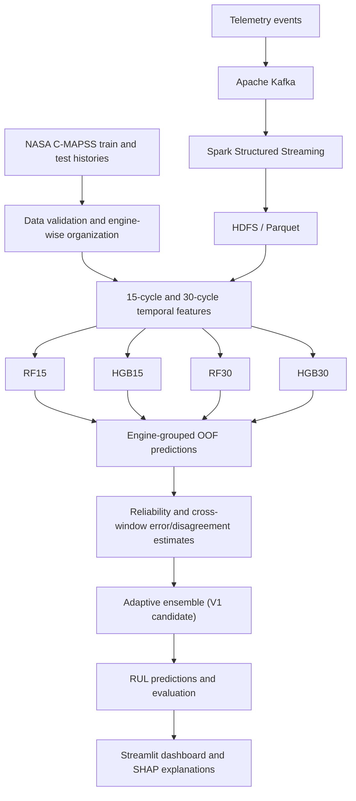

<div align="center">

# DARE-RUL

### Distributed, Multi-Resolution Adaptive Ensemble for Remaining Useful Life Prediction

**A reproducible Big Data and Machine Learning framework for turbofan-engine health estimation**

[](https://www.python.org/)
[](https://kafka.apache.org/)
[](https://spark.apache.org/)
[](https://streamlit.io/)

</div>

---

## 1. Project Overview

DARE-RUL is an end-to-end research prototype for estimating the **Remaining Useful Life (RUL)** of aircraft turbofan engines using the NASA C-MAPSS dataset.

RUL answers a practical question:

> Based on the engine's condition today, approximately how many operating cycles remain before it reaches the end of its useful life?

The project combines a streaming data pipeline, multi-resolution feature engineering, four tree-based regression experts, an out-of-fold (OOF) reliability-aware ensemble, and an interactive dashboard with SHAP explainability.

The system is evaluated on all four C-MAPSS subsets: **FD001, FD002, FD003 and FD004**.

**Project status:** the core pipeline, baseline models, original adaptive ensemble, official test evaluation and dashboard are implemented. A grouped nested training-only validation experiment has also evaluated an alternative ensemble configuration. It found no material improvement over the original adaptive ensemble; the original method remains the current candidate. Research-protocol closure and final academic-document polishing remain separate work.

## 2. Problem Statement and Research Question

Aircraft engines produce multivariate sensor readings throughout their operation. As components degrade, these readings change over time. Predicting RUL from these changing signals is difficult because:

- degradation is nonlinear and may evolve at different rates;
- operating conditions and fault modes vary across engines;
- individual sensors may be noisy or weak indicators on their own;
- the data consists of long, engine-specific sequences rather than independent rows;
- large telemetry streams require reliable ingestion, processing and storage.

**Research question**

Can multi-resolution temporal features and an OOF-calibrated adaptive ensemble improve RUL estimation across different turbofan operating conditions, while being supported by a reproducible streaming-data pipeline?

The project also studies the engineering path from telemetry ingestion to model-ready features, prediction, evaluation and explanation.

## 3. Dataset

### NASA C-MAPSS

The project uses the Commercial Modular Aero-Propulsion System Simulation (C-MAPSS) turbofan-engine dataset.

Each engine is represented by cycle-wise operating conditions and sensor measurements. The training trajectories include run-to-failure histories. The official test trajectories stop before failure and are accompanied by separate RUL target files.

| Subset | Training engines | Official test engines | Characteristics |
|---|---:|---:|---|
| FD001 | 100 | 100 | One operating condition, one fault mode |
| FD002 | 260 | 259 | Multiple operating conditions, one fault mode |
| FD003 | 100 | 100 | One operating condition, multiple fault modes |
| FD004 | 249 | 248 | Multiple operating conditions and fault modes |
| **Total** | **709** | **707** | Four complementary evaluation settings |

### Data usage

- `train_FD00*.txt` is used for feature construction, engine-level training/validation splits, expert fitting and OOF ensemble calibration.
- `test_FD00*.txt` provides the observed sensor histories for final inference. Test features are created separately for each engine.
- `RUL_FD00*.txt` contains the official RUL targets for scoring the final test predictions. These targets are not model input features and are not used to fit the experts or the gate.

The current experiment configuration uses a **125-cycle training-label cap**. Its final research-protocol status is subject to the project's research review. The Phase 8 official test predictions were saved before the corresponding official labels were loaded for scoring.

Raw dataset files are not included in this repository. Place the downloaded files in the locally configured C-MAPSS data directory; see `.gitignore` and the project runbooks.

## 4. Methodology

### 4.1 End-to-end architecture



### 4.2 Data ingestion and processing

The streaming path is:

**Kafka → Spark Structured Streaming → HDFS / Parquet**

- Kafka receives cycle-level telemetry events.
- Spark validates and processes incoming records.
- Valid records are persisted as Parquet data in HDFS.
- Data-quality checks cover invalid records, duplicates and cycle-order warnings.

The completed Kafka smoke-test matrix contains eight dataset/split scenarios with 500 events each. The Spark/HDFS integration was verified using a local single-worker, single-DataNode setup.

### 4.3 Multi-resolution feature engineering

Two temporal views are constructed for each engine:

- **15-cycle window:** captures shorter-term changes.
- **30-cycle window:** captures broader degradation trends.

Features include rolling statistics and temporal changes such as means, standard deviations and deltas. The feature-generation process preserves engine boundaries so that one engine's history is not mixed with another's.

The resulting feature set contains 152 columns. Feature calculations use current and past observations; future cycles and official test RUL targets are not input features.

### 4.4 Baseline experts

Four regression experts are trained:

| Expert | Model | Feature view |
|---|---|---|
| RF15 | Random Forest Regressor | 15-cycle features |
| HGB15 | HistGradientBoosting Regressor | 15-cycle features |
| RF30 | Random Forest Regressor | 30-cycle features |
| HGB30 | HistGradientBoosting Regressor | 30-cycle features |

The experts provide different views of engine degradation. Their predictions are compared individually and as ensembles.

### 4.5 OOF adaptive ensemble — V1

The original adaptive ensemble uses engine-grouped out-of-fold predictions to estimate expert reliability without evaluating an engine using an expert trained on that same engine.

The method combines:

1. predictions from the four experts;
2. OOF-derived estimates of expert error/reliability;
3. information about disagreement between the 15-cycle and 30-cycle views;
4. an adaptive selection/blending rule.

The intention is to rely more on experts that are expected to perform better for the current prediction context. The method is compared with individual experts, equal averaging and static OOF reliability weighting.

### 4.6 V2 nested-validation experiment

A second configuration introduced bounded/shrinkage-stabilized adaptive weights and selected its settings inside grouped nested training folds.

- 5 outer engine-grouped folds;
- 3 inner OOF folds;
- 3 parameter-selection/gate folds;
- all four C-MAPSS subsets;
- official test files and official test RUL labels were not loaded.

The selected shrinkage was zero in every outer fold. Consequently, nested-selected V2 produced predictions effectively equivalent to V1. **No material improvement was demonstrated**, so V1 remains the current ensemble candidate and V2 is retained as an evaluated alternative.

The nested experiment is reported as exploratory because earlier validation cohorts and V2 comparisons had already been examined. It is not described as an untouched independent confirmation.

## 5. Evaluation Protocol

### Validation and test separation

- Training/validation partitions are made at the **engine level**; cycles from the same engine remain together.
- OOF predictions are used for ensemble reliability/gate calibration.
- The outer grouped validation experiment evaluates models on engines excluded from the corresponding expert and gate fitting.
- The official C-MAPSS test histories are used for final inference.
- The official `RUL_FD00*.txt` labels are used only for final scoring of the frozen Phase 8 predictions.

### Metrics

- **RMSE:** gives larger errors more influence.
- **MAE:** average absolute prediction error in cycles.
- **NASA/PHM08 score:** asymmetric penalty that penalizes late RUL predictions more heavily than early predictions.

Nested-validation outputs also report engine-macro metrics so that engines with more cycle rows do not automatically dominate every summary.

## 6. Results

### 6.1 Frozen official test evaluation

The Phase 8 run produced predictions and scored results for **707 official test engines**.

| Subset | Test engines | RMSE | MAE | NASA score sum |
|---|---:|---:|---:|---:|
| FD001 | 100 | 16.9346 | 12.4489 | 587.3681 |
| FD002 | 259 | 29.0353 | 20.3818 | 10,330.7444 |
| FD003 | 100 | 18.2843 | 13.0945 | 1,256.5902 |
| FD004 | 248 | 29.9007 | 22.3560 | 7,928.2319 |

These are the frozen Phase 8 results for the recorded model/configuration. The NASA score sum depends on the number of evaluated engines and should not be compared across subsets as if it were a normalized metric.

### 6.2 Grouped nested training-only validation

| Subset | V1 RMSE | Nested V2 RMSE | V1 MAE | Nested V2 MAE |
|---|---:|---:|---:|---:|
| FD001 | 16.6360 | 16.6360 | 12.1069 | 12.1069 |
| FD002 | 19.4289 | 19.4289 | 14.4546 | 14.4546 |
| FD003 | 14.5970 | 14.5970 | 9.4194 | 9.4194 |
| FD004 | 17.7077 | 17.7077 | 12.2285 | 12.2285 |

The V1/V2 differences are negligible. The results support retaining V1 as the current candidate rather than claiming that V2 improves prediction accuracy.

### 6.3 Streaming pipeline benchmark

The local replay/drain benchmark verified three workload sizes:

| Requested messages | Delivered / valid HDFS rows | Spark/HDFS elapsed time | Approx. end-to-end rows/s |
|---:|---:|---:|---:|
| 500 | 500 | 29.33 s | 17.05 |
| 5,000 | 5,000 | 59.35 s | 84.25 |
| 20,000 | 20,000 | 151.77 s | 131.78 |

The recorded runs reported zero invalid rows, duplicate engine-cycle pairs and cycle-order warnings. These are local replay/drain measurements, not a multi-node scaling or production real-time benchmark.

## 7. Dashboard and Explainability

The Streamlit dashboard provides an interactive view of the saved project artifacts.

| Dashboard area | Purpose |
|---|---|
| Fleet overview | Filter by C-MAPSS subset and illustrative risk tier; inspect engine predictions and export selected rows |
| Model evaluation | View saved RMSE, MAE and NASA metrics, predictions and error distributions |
| Ensemble analysis | Inspect expert predictions, adaptive weights and the final ensemble estimate |
| Explainability | View SHAP global feature importance and local feature contributions for a selected prediction |
| Pipeline performance | Explore the 500, 5,000 and 20,000-message replay/drain measurements |

SHAP explanations are model attributions relative to the chosen background data. They are not causal explanations. The dashboard is an offline research and analysis interface; the illustrative risk bands are not aviation maintenance instructions.

## 8. Repository Structure

```text
DARE-RUL/
├── config/                 # Project configuration
├── dashboard/              # Streamlit application and dashboard modules
├── data/                   # Local datasets and generated features (not all tracked)
├── docker/                 # Kafka, Spark and HDFS environment
├── docs/
│   └── project/            # Architecture, protocols, runbooks and result summaries
├── logs/                   # Local execution logs
├── models/                 # Locally saved trained models
├── notebooks/              # Exploration and analysis
├── results/                # Local experiment outputs
├── scripts/
│   ├── phase2/             # Kafka ingestion
│   ├── phase3/             # Spark/HDFS processing
│   ├── phase4/             # Feature engineering
│   ├── phase5/             # Baseline models
│   ├── phase6/             # Adaptive ensemble
│   ├── phase7/             # Ablations and benchmarks
│   ├── phase8/             # Official evaluation
│   └── phase9/             # Nested validation, dashboard support and checks
├── src/                    # Shared project source
├── tests/                  # Unit and integration tests
├── .gitignore
├── pytest.ini
├── README.md
├── requirements-base.txt
├── requirements-dashboard.txt
└── requirements-lock.txt
```

Local datasets, generated feature files, models, checkpoints, logs and result CSVs are not necessarily tracked by Git. See `.gitignore` and the documentation for the exact local setup.

## 9. Setup and Running

### Requirements

The recorded development environment uses:

- Python 3.10.11
- Git
- Docker Desktop and Docker Compose
- Java 11
- WSL2 on Windows
- Apache Kafka, Apache Spark and HDFS through the project Docker setup

### Create / activate the environment

From the repository root in PowerShell:

```powershell
python -m venv .venv
.\.venv\Scripts\Activate.ps1
python -m pip install --upgrade pip
pip install -r requirements-base.txt
```

Install dashboard dependencies when needed:

```powershell
pip install -r requirements-dashboard.txt
```

Use the project's lock file and runbooks when reproducing the exact tested environment.

### Run tests

```powershell
.\.venv\Scripts\python.exe -m pytest -q
```

The latest reported full regression run passed **56 tests**. Re-run the suite after changing code or dependencies.

### Launch the dashboard

```powershell
.\.venv\Scripts\python.exe -m streamlit run .\dashboard\app.py
```

Open `http://localhost:8501` in a browser.

### Inspect nested-validation results

```powershell
Get-Content .\results\phase9\nested_validation\nested_cv_summary.md

Import-Csv .\results\phase9\nested_validation\nested_cv_metrics.csv |
    Format-Table subset, method, rmse, mae, nasa_score_mean -AutoSize
```

### Run the streaming pipeline

Use the maintained project runbooks under `docs/project/` and scripts under `scripts/phase2/` and `scripts/phase3/` to start the services, verify the cluster and run the ingestion/processing checks. The benchmark scripts and exact tested arguments are documented in the Phase 7 runbook.

## 10. Reproducibility, Data and Limitations

- Engine-level separation is essential because cycles from one engine are related observations.
- Official test RUL labels are reserved for scoring the frozen Phase 8 predictions; they are not training features.
- The training RUL cap of 125 is the current experiment setting and remains subject to final research-protocol confirmation.
- The local Spark/HDFS environment uses one worker and one DataNode. The project does not claim production high availability, fault recovery or horizontal scaling.
- V2 did not demonstrate a material improvement over V1 in the completed nested-validation experiment.
- Phase 8's protocol-approval metadata must be supported by a genuine pre-scoring approval record before the scores are described as a formally pre-approved final evaluation.
- The recorded Phase 8 elapsed-time field requires timer-semantics verification before it is reported as model runtime.
- The project is a research prototype using simulated turbofan data. It is not an approved aviation maintenance or safety system.

Do not commit raw C-MAPSS data, virtual environments, model binaries, large generated predictions, checkpoints, secrets or credentials. Keep curated code, tests and documentation in Git.

## 11. Research Positioning and Contribution

DARE-RUL brings together:

1. a reproducible Kafka–Spark–HDFS telemetry processing path;
2. engine-wise multi-resolution temporal feature construction;
3. four complementary tree-based regression experts;
4. engine-grouped OOF reliability calibration and adaptive ensemble selection;
5. an interactive evaluation and SHAP dashboard.

The contribution is positioned as an integrated, evaluated workflow and an adaptive ensemble design for this project setting. The current results do **not** establish state-of-the-art performance, universal ensemble superiority or a first-ever method. Those claims require a completed literature comparison and controlled evaluation against the closest published approaches.

## 12. References

1. A. Saxena, K. Goebel, D. Simon and N. Eklund, “Damage Propagation Modeling for Aircraft Engine Run-to-Failure Simulation,” *International Conference on Prognostics and Health Management (PHM)*, 2008.
2. NASA Prognostics Center of Excellence, “C-MAPSS Turbofan Engine Degradation Simulation Data,” NASA Ames Research Center.
3. NASA Prognostics Data Repository, C-MAPSS dataset documentation and associated data files.
4. S. Hochreiter and J. Schmidhuber, “Long Short-Term Memory,” *Neural Computation*, vol. 9, no. 8, pp. 1735–1780, 1997. (Background reference for sequence-based degradation modelling; not a component of the current tree-ensemble implementation.)
5. L. Breiman, “Random Forests,” *Machine Learning*, vol. 45, pp. 5–32, 2001.
6. J. H. Friedman, “Greedy Function Approximation: A Gradient Boosting Machine,” *The Annals of Statistics*, vol. 29, no. 5, pp. 1189–1232, 2001.
7. S. M. Lundberg and S.-I. Lee, “A Unified Approach to Interpreting Model Predictions,” *Advances in Neural Information Processing Systems*, 2017.

The final research paper should expand this list with the closest C-MAPSS RUL ensemble, multi-resolution feature, OOF stacking/gating and explainability studies from the project's literature matrix. Verify each bibliographic entry against its original publication before submission.
